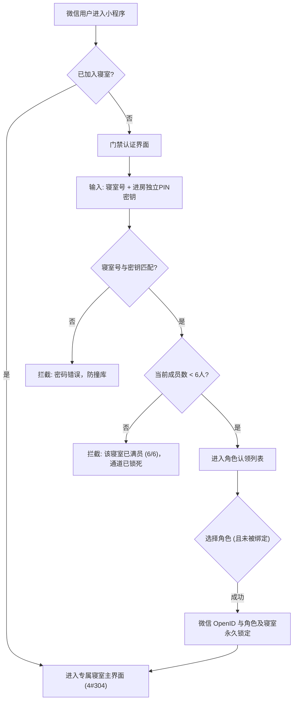

# 产品需求规格说明书 (PRD)

| 项目名称 | 寝室专属搞笑日常小程序 (Dorm Daily Fun) |
| :--- | :--- |
| 文档版本 | v1.0.0 (Release Candidate Spec) |
| 目标平台 | 微信小程序 (WeChat Mini Program) |
| 当前阶段 | Stage 1: 业务需求冻结与评审卡点 |
| 核心定位 | 专属于大学寝室的高私密、强互动、0运营成本的沙雕日常留档与娱乐小程序 |

---

## 1. 项目背景与产品愿景 (Vision)

### 1.1 现状与痛点
* **腾讯文档 / 语雀 / Notion**：
  * **形态过正**：本质是生产力与文档协作工具，界面严肃，缺少“寝室特有的沙雕娱乐感”和“归属感”。
  * **私密性与仪式感不足**：没有专属的“寝室门牌”与“室友角色绑定”，各记各的，缺乏即时互动（如沙雕评分、抽签转盘、黑料小报）。
* **微信聊天记录**：
  * **极易被刷屏遗忘**：寝室群里每天诞生的离谱梦话、绝妙金句、逆天事件，几天后就被海量表情包淹没，无法系统性沉淀和检索。

### 1.2 核心目标
打造一个**专属、封闭、安全、充满梗文化**的小程序空间，让寝室成员能够：
1. **一键存证**：秒级记录室友出糗、梦话、暴论与名场面。
2. **多维互动**：为事件评定“沙雕指数”，进行寝室专属表态与神评。
3. **日常互助与游戏化**：通过“命运转盘”和平解决谁倒垃圾、谁去拿外卖等寝室世纪难题。
4. **长久回忆沉淀**：期末或毕业时一键导出“寝室年度黑料小报”。

---

## 2. 用户角色与多租户私密安全机制 (Multi-Tenant Security)

为彻底杜绝“被外人蹭寝”、“数据泄露”以及“多寝室接入互相串门”的风险，系统执行严格的多租户与容量门禁策略。

### 2.1 寝室容量与首发预设 (4#304)
* **首发寝室代号**：`4#304`
* **寝室物理人数上限**：**6人（满员直接关门锁死）**
* **预设专属角色池**：
  1. `寝室长`（具备审批、设置寝室公告与暗号管理权）
  2. `小肥肥`
  3. `晴晴姨`
  4. `皇上`
  5. `哈基`
  6. `王晨`

### 2.2 防蹭寝与多寝室强隔离规则

1. **双重凭据验证**：进入寝室必须同时匹配 `寝室代号(RoomCode)` + `独立入寝密钥(SecretPIN)`，防止单纯靠房号撞库。
2. **动态容量与成员管控（可增减与移除）**：
   - 默认额定人数为 6 人，但**寝室长具备管理员权限**，可根据后续实际情况动态调整寝室人数上限（扩容/缩容）。
   - 寝室长可执行“**移出寝室**”管理操作：将某位成员移除后，其绑定的角色名额立即释放回可选角色池，被移出人员立即丧失本寝室的访问与数据读取权限。
   - 准入强校验：当已加入人数达到当前设定上限时，后台自动阻断新成员准入。
3. **角色唯一认领**：角色与微信用户的 `OpenID` 绑定。一旦某个角色被认领，其他微信账号无法二次认领，防止寝室内假冒身份。
4. **行级数据物理隔离 (RLS)**：所有事件、金句、图片数据均强关联 `dorm_id`。所有查询请求在网关层执行用户归属过滤，非本寝成员即使拿到直接数据 ID 也无权读取。

---

## 3. 功能模块详细需求规格 (Feature Requirements)

### 模块一：寝室空间与门禁系统 (Room Guard)
* **FR-101 门禁校验**：未入寝用户只能停留在门禁页，无法浏览任何内容。
* **FR-102 快速认证入寝**：支持输入 `4#304` 及密钥加入。
* **FR-103 角色认领与身份卡**：
  * 展示当前寝室剩余未被认领的角色列表。
  * 用户选定角色后生成个人“室友通行卡”，支持自定义个性签名与头像。
* **FR-104 寝室信息看板与成员管理**：
  * 展示寝室成员在席状态、成员清单、寝室已建立天数。
  * 寝室长控制台：支持修改人数上限、移出成员、重置入寝密钥。

### 模块二：沙雕日常流与存证发布 (Funny Post & Feed)
* **FR-201 快速发布器**：
  * **事件正文**：支持多行文字输入，支持快捷插入流行沙雕梗词条。
  * **事发当事人（单选/多选）**：从寝室成员列表中选择本次事件的核心“受害人/主角”（如“@王晨”、“@皇上”）。
  * **沙雕指数评级**：1~5 星离谱评定（1星: 微笑打卡 ➔ 5星: 逆天核爆级）。
  * **三大核心分类标签**：
    1. 🎭 `[宿舍搞笑日常]`：日常搞笑出糗、名场面、翻车实录。
    2. 📜 `[黑话梗合集]`：寝室自创暴论、专属谐音黑话，发布后自动沉淀至黑话词库。
    3. 🕵️ `[来吐槽吧]`（**匿名树洞模式**）：
       - 当选择此标签时，系统自动开启**匿名机制**。
       - 发布者的真实头像与昵称全部遮蔽为“**神秘室友**”。
       - 所有人均可以匿名发表评论，打造无心理压力的真实吐槽空间，没人能知道谁是谁。
    - 辅助标签：`[梦话暴论]`、`[外卖奇遇]`、`[打呼连环]`、`[破防时刻]`。
  * **现场配图规格与限制**：
    - **数量限制**：支持上传 1~9 张照片。
    - **格式限制**：支持 `JPG`、`PNG`、`WEBP`、`GIF`。
    - **大小限制**：单张限制 <= `5MB`，前端在选图后自动进行智能轻量压缩，保证画质同时节省网络流量。
* **FR-202 时间线主页 (Feed)**：
  * 卡片式流布局，最新发布的事件置顶。
  * 卡片包含：事发日期、发布人（匿名模式下为“神秘室友”）、@当事人彩色胶囊 Tag、事件正文、图片九宫格展示（点击支持全屏放大查看）、沙雕指数星级。

### 模块三：沙雕互动与神评机制 (Interactions & Comments)
* **FR-301 专属沙雕表态与 Emoji 支持 (Reactions)**：
  * **预设 4 款寝室专属快捷表情**：
    * 🤣 `笑喷`
    * 🤯 `逆天`
    * 📁 `留档存证`
    * 🚪 `开除寝籍`
  * **全量 Emoji / 输入法表情扩展**：
    * 表态栏支持展开 Emoji 选择器，用户可发送任意标准 Unicode 表情（如 👋, 🤡, 💩, 💀, 🐂, 🍺 等）。
    * 采用乐观更新（Optimistic UI），点击瞬间数字加 1，不卡顿。
* **FR-302 室友神评吐槽**：
  * 卡片底部支持展开室友吐槽列表，纯寝室成员内部评论，支持当事人“自辩”。
  * 评论输入框支持原生输入法任意 Emoji 表情（如 👋、[旺柴] 等）。在“来吐槽吧”帖子下，评论全部匿名展示。

### 模块四：寝室金句与黑话梗合集 (Quotes & Slang Dictionary)
* **FR-401 金句与黑话融合展示**：
  * 首页顶部沉浸式轮播寝室高赞金句与黑话词条（如：“*‘这道题选C，不选C我倒立洗头’ —— 皇上 2026.10.15*”）。
  * 独立“黑话词典”专栏：展示 `[黑话梗合集]` 沉淀的所有经典词条、释义与典故。
* **FR-402 一键上墙与收录**：
  * 发布日常带有 `[黑话梗合集]` 标签时自动入库；在浏览任何日常评论时，支持点击“收录为寝室黑话金句”。

### 模块五：寝室命运之轮 (Dorm Fortune Wheel)
* **FR-501 经典决策转盘**：
  * **三大预设日常决策场景**：
    1. 🛠️ **谁来报修**
    2. 💡 **谁下床关灯**
    3. 📦 **谁帮忙拿快递**
  * 支持自定义新增临时抽签场景。
  * 转盘扇区自动动态填充寝室当前在席成员名字（寝室长、小肥肥、晴晴姨、皇上、哈基、王晨...）。
  * 点击开始，高帧率转动并随机选出“今日天选倒霉蛋”，伴随搞笑文案播报。

### 模块六：年度/月度黑料报导出 (Black Book Recap)
* **FR-601 聚合统计**：
  * 统计本月/本年度“被 @ 当事人次数最多的人”（荣获“年度沙雕之王”称号）。
  * 统计“最高沙雕指数事件 TOP 3”。
* **FR-602 一键海报生成**：
  * 前端 Canvas 一键合成复古小报风格的长图海报，支持直接保存到手机相册或分享至微信寝室群。

---

## 4. 非功能性需求与设计约束 (Non-Functional Requirements)

1. **0 运营费用原则**：
   * 严禁产生任何按月扣费的云开发固定支出。数据层采用通用适配器设计，支持纯本地 Mock 离线运转与永久免费 BaaS 存储无缝切换。
2. **极速响应性能**：
   * 列表加载时间 < 800ms。
   * 点赞/表态本地秒级响应，网络异步静默同步。
3. **数据安全性**：
   * 租户数据 100% 隔离，绝无可能被非寝室成员跨权限越权访问。
4. **端侧兼容性**：
   * 完美适配 iOS、Android 微信环境以及各类全面屏安全区域（Safe Area）。

---

## 5. 阶段交付物与卡点评审规范 (Quality Gate 1)

* **交付产物**：本需求文档 (`docs/PRD.md`)
* **卡点要求**：必须经用户评审，确认功能范围、角色设置、多租户安全机制无误后，才可推进至 **Stage 2：技术架构设计与规格说明书 (`docs/TECH_SPEC.md`)**。
