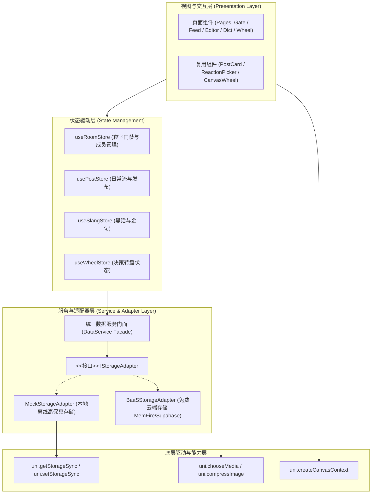
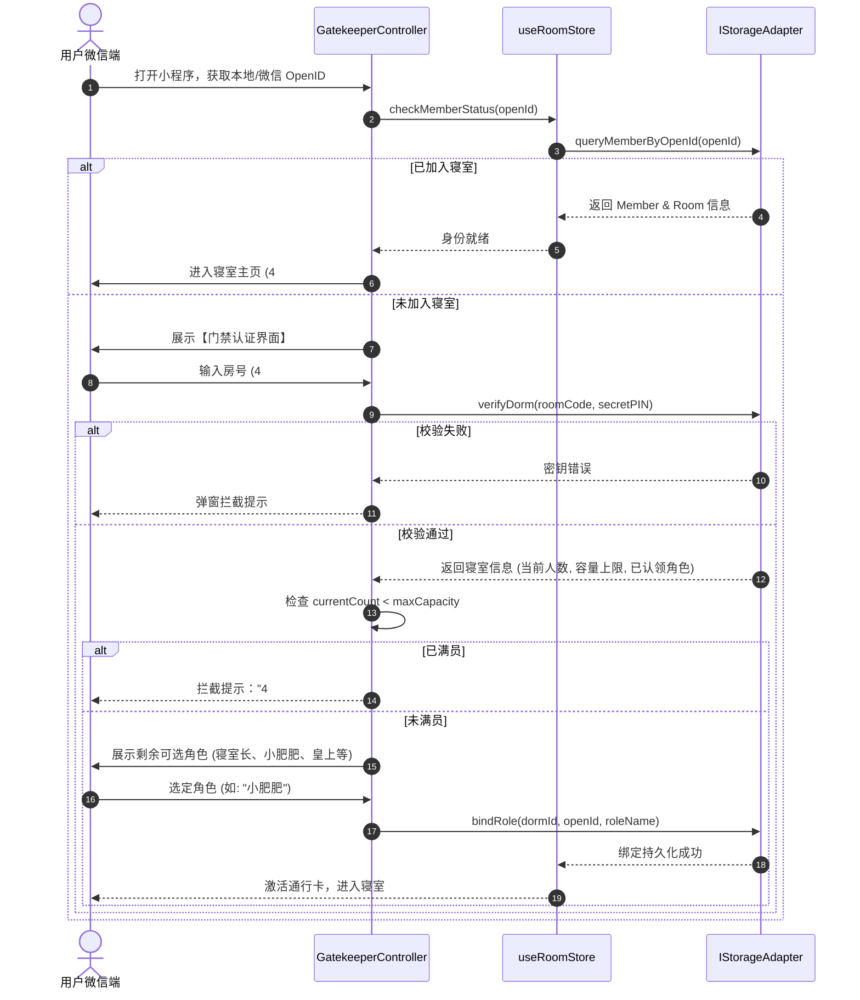

# 技术架构设计与数据规格说明书 (TECH_SPEC)

| 项目名称 | 寝室专属搞笑日常小程序 (Dorm Daily Fun) |
| :--- | :--- |
| 文档版本 | v1.0.0 (Architecture Baseline) |
| 依赖标准 | 微信小程序基础库 3.0+ / Uni-app Vue 3.4+ / Vite 5+ |
| 当前阶段 | Stage 2: 技术方案设计与评审卡点 |
| 核心架构 | 跨端响应式 + 存储适配器分层 + 强隔离多租户模型 |

---

## 1. 系统总体架构设计 (System Architecture)

系统采用典型的**分层解耦与适配器架构**，最大程度保证客户端 UI 与底层数据存储方案的完全隔离。



### 1.1 核心技术选型
* **前端框架**：Vue 3.4 (`<script setup>` + Composition API)
* **跨端编译器**：Uni-app + Vite 5.2
* **状态管理**：Pinia 2.x
* **CSS 预处理**：SCSS（内置微信全面屏安全区适配 `env(safe-area-inset-bottom)`）
* **存储适配策略**：
  * **开发与演示期**：`MockStorageAdapter`，基于本地高保真离线持久化，100% 模拟多寝室隔离与网络延迟，开发调试零成本。
  * **生产部署期**：`BaaSStorageAdapter`，对接永久免费云端服务（零服务器费用），通过 `VITE_STORAGE_MODE` 环境变量一键热切换，业务代码零改动。

---

## 2. 数据模型与 TypeScript 实体定义 (Data Models)

所有核心实体均建立在强类型声明之上，路径位于 `src/types/`。

### 2.1 寝室实体 (Room) & 成员实体 (Member)
```typescript
// 寝室实体
export interface Room {
  id: string;              // 唯一寝室 ID (如: "dorm_4_304")
  roomCode: string;        // 门牌代号 (如: "4#304")
  secretPIN: string;       // 6位加密进房密钥
  maxCapacity: number;     // 动态人数上限 (默认 6，寝室长可调整)
  ownerOpenId: string;     // 寝室长微信标识
  notice: string;          // 寝室公告/搞笑标语
  createdAt: number;       // 创建时间戳
}

// 成员身份实体
export interface Member {
  id: string;              // 成员唯一 ID
  openid: string;          // 绑定的微信 OpenID
  dormId: string;          // 所属寝室 ID (多租户归属)
  roleName: '寝室长' | '小肥肥' | '晴晴姨' | '皇上' | '哈基' | '王晨' | string;
  customNickname?: string; // 允许室友自定义展示昵称
  avatarUrl: string;       // 头像 URL
  isOwner: boolean;        // 是否是管理员(寝室长)
  joinedAt: number;        // 加入时间戳
}
```

### 2.2 沙雕日常流实体 (Post)
```typescript
export type PostTag = 
  | '宿舍搞笑日常' 
  | '黑话梗合集' 
  | '来吐槽吧' 
  | '梦话暴论' 
  | '外卖奇遇' 
  | '打呼连环' 
  | '破防时刻';

export interface Post {
  id: string;              // 事件唯一 ID
  dormId: string;          // 强绑定的寝室 ID (行级隔离核心)
  authorId: string;        // 发起人 memberId
  authorName: string;      // 发起人角色名 (若 isAnonymous 为 true，展示为 "神秘室友")
  authorAvatar: string;    // 发起人头像 (匿名时替换为预设匿名头像)
  isAnonymous: boolean;    // 是否为匿名吐槽模式 (由 [来吐槽吧] 标签触发)
  targetGuyIds: string[];  // @当事人室友的 memberId 列表
  content: string;         // 事件文字正文
  images: string[];        // 现场配图列表 (0~9 张，单张 <= 5MB)
  funnyLevel: number;      // 沙雕指数 (1~5 星)
  tag: PostTag;            // 核心分类标签
  reactions: Record<string, number>; // 表态统计: { '🤣': 5, '🤯': 2, '👋': 3 }
  reactedUsers: Record<string, string[]>; // 防重复表态: { '🤣': ['user_1', 'user_2'] }
  commentCount: number;    // 评论总数
  createdAt: number;       // 事发时间戳
}
```

### 2.3 评论实体 (Comment) & 黑话金句实体 (SlangQuote)
```typescript
export interface Comment {
  id: string;
  postId: string;          // 所属事件 ID
  dormId: string;          // 寝室 ID 隔离
  authorId: string;
  authorName: string;      // 匿名树洞下为 "神秘室友"
  authorAvatar: string;
  isAnonymous: boolean;
  content: string;         // 评论内容 (支持标准 Emoji)
  createdAt: number;
}

export interface SlangQuote {
  id: string;
  dormId: string;
  content: string;         // 黑话金句内容
  speakerRole: string;     // 说话人/当事人
  explanation?: string;    // 黑话出处释义
  originPostId?: string;   // 关联的原始事件 ID
  likesCount: number;      // 金句点赞数
  createdAt: number;
}
```

---

## 3. 核心业务流程与时序设计 (Flows & Sequences)

### 3.1 门禁与角色认领状态机 (Gatekeeper Flow)


### 3.2 匿名吐槽与黑话自动收录管道 (Publish Pipeline)
当用户点击“发布日常”时，触发如下处理流水线：
1. **图片预检与轻量压缩**：
   - 过滤非法格式，单张限制 `<= 5MB`。
   - 若大于 1MB，自动调用 Canvas/API 压缩至 80% 质量。
2. **标签分支决策 (Tag Interceptor)**：
   - **分支 A：`[来吐槽吧]`** ➔ 强制设置 `isAnonymous = true`，自动将 `authorName` 替换为 `"神秘室友"`，头像设为预设黑色斗篷图标，切断任何个人特征。
   - **分支 B：`[黑话梗合集]`** ➔ 自动触发 `SlangService.createFromPost()`，将该条正文和当事人自动存入寝室黑话词典库。
   - **分支 C：`[宿舍搞笑日常]`** ➔ 标准发布流程。
3. **乐观写入 (Optimistic Insert)**：
   - 本地前端列表秒级 `unshift()` 插入卡片，异步提交底层存储，网络出错自动滚回并 Toast 告警。

---

## 4. 模块结构与代码工程组织 (Scaffolding & File Structure)

项目将按照清晰的单一职责原则划分目录：

```text
D:\dorm-daily-fun\src\
├── api/                           # 数据接口与存储适配器
│   ├── index.ts                   # 数据服务入口 (统一 Facade)
│   ├── IStorageAdapter.ts         # 抽象存储契约接口
│   ├── MockStorageAdapter.ts      # 本地高保真离线适配器
│   └── CloudStorageAdapter.ts     # 免费云端 BaaS 适配器
├── components/                    # 通用业务组件
│   ├── PostCard.vue               # 搞笑事件卡片 (九宫格/星级/@胶囊)
│   ├── ReactionPicker.vue         # 专属表情 + Emoji 展开选择器
│   ├── CommentList.vue            # 评论吐槽列表 (含匿名支持)
│   └── WheelCanvas.vue            # Canvas 决策大转盘组件
├── pages/                         # 路由页面
│   ├── gate/                      # 门禁与角色认领页
│   ├── index/                     # 首页 (沙雕时间线 + 今日金句轮播)
│   ├── post-editor/               # 发布日常页 (标签/选人/压缩上传)
│   ├── slang-dict/                # 寝室黑话词典与金句墙
│   ├── fortune-wheel/             # 寝室命运之轮 (报修/关灯/快递)
│   └── admin/                     # 寝室长管理后台 (容量调整/移出成员)
├── stores/                        # Pinia 状态树
│   ├── room.ts                    # 寝室与成员状态
│   ├── post.ts                    # 沙雕流状态
│   ├── slang.ts                   # 黑话金句状态
│   └── wheel.ts                   # 转盘预设状态
├── types/                         # TypeScript 接口规范
│   ├── room.d.ts
│   ├── post.d.ts
│   └── slang.d.ts
└── utils/                         # 纯函数工具库
    ├── imageCompressor.ts         # 图片自动轻量压缩工具
    ├── dateHelper.ts              # 相对时间与友善时间格式化
    └── posterGenerator.ts         # Canvas 黑料小报海报生成器
```

---

## 5. 质量防护与非功能性保障 (Quality & Reliability)

1. **防抖与防刷 (Debounce & Throttling)**：
   - 发布按钮添加 1.5s 防重复点击锁。
   - 表态 Reaction 采用前端防抖合并，1 秒内同一表情多次点击自动合并为 1 次变更请求。
2. **多租户安全拦截器 (Tenant Guard)**：
   - 每一个查询请求自动注入 `activeDormId`。
   - 底层适配器在返回数据前，强校验 `item.dormId === activeDormId`，杜绝任何串寝数据泄漏。
3. **输入防呆与字符限制**：
   - 日常文字限制 500 字，评论限制 150 字，防止大段无意义文本破坏卡片瀑布流。

---

## 6. 阶段交付物与卡点评审规范 (Quality Gate 2)

* **交付产物**：本技术架构文档 (`docs/TECH_SPEC.md`)
* **卡点要求**：请评审系统分层、实体定义、适配器方案与门禁状态机。确认无误后，将进入 **Stage 3：自动化工程化配置与测试基建 (ESLint / Git Commit / Vitest)**！
